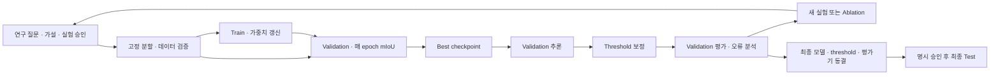
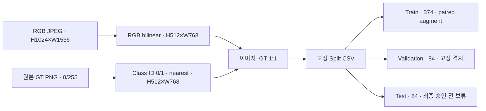
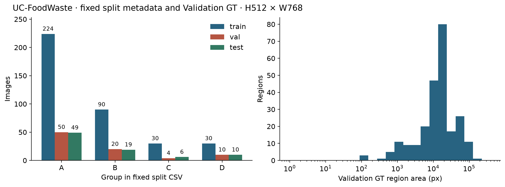
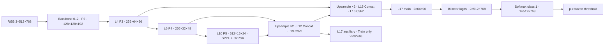
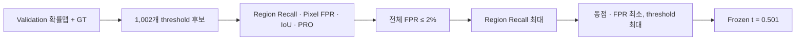

# 연구 그림과 생성 방법

## 전체 연구 파이프라인



## 전처리와 분할





Test 막대는 CSV에 기록된 표본 수다. 크기 분포는 Validation GT만 이용했다. 실제 RGB·마스크와 예측 예시는 로컬 `runs/Exp01_RGB_Baseline/figures/examples/`의 6패널 PNG로 생성된다. RGB는 원본 JPG에서 읽어 평가 격자 또는 확대 ROI로 표시한다. GitHub용 문서에는 집계 그림과 구조도만 저장한다.

## YOLO26s-sem



입력 크기는 H512×W768이다. [전체 레이어 C×H×W](../MODEL.md#실제-레이어와-입력-크기) · [CPU shape trace CSV](exp01_feature_maps.csv)

## Threshold Optimization



[곡선 PNG](exp01_threshold_analysis.png) · [학습 이력 PNG](exp01_learning_curves.png) · [오류 분석 PNG](exp01_error_analysis.png) · [그룹별 성능 PNG](exp01_group_metrics.png) · [효율 PNG](exp01_model_efficiency.png)

## 재생성 명령

아래 명령은 PowerShell의 저장소 루트에서 실행한다. 출력에는 존재하지 않는 새 경로를 사용한다. `--profile-checkpoint`는 신뢰할 수 있는 Ultralytics 체크포인트를 CPU에서 로딩하고 THOP로 연산량을 추정한다. 옵션을 생략하면 GFLOPs는 미측정으로 남는다.

```powershell
$py = '.\.venv\Scripts\python.exe'
& $py scripts/visualization/render.py run runs/Exp01_RGB_Baseline --profile-checkpoint --out runs/exp01_figures_new
& $py scripts/visualization/render.py dataset --regions runs/exp01_figures_new/region_profile.csv --out runs/dataset_figures_new
& $py scripts/visualization/render.py compare runs/exp01_figures_new/comparison_input.json --out runs/comparison_new
```

`run`에는 `history.csv`, `val_metrics.json`, `val_results.csv`, `val_groups.csv`, `threshold.json`, `threshold_search.csv`, `environment.json`, `run_config.json`, `train_resources.json`과 `probability_maps/val/`이 필요하다. 공통 입력 데이터 루트와 split 경로는 `--data-root`와 `--split-csv`로 지정한다. 생성물은 SVG·PNG, 정량 CSV, 모델 구조 CSV, 비교용 JSON이다. 검증기는 현재 아티팩트 계약과 region 수식을 사용하는 run의 이미지별 혼동행렬과 영역 집계를 대조한다.

`compare`에는 실제 run의 `comparison_input.json`을 여러 개 전달할 수 있다. split 해시, Validation GT 해시, 해상도, 영역 규칙, threshold 정책, FPR 제한, 평가기 ID가 다른 묶음은 거부한다. 추론 시간의 장비·dtype/범위·입력 shape·런타임이 다르면 trade-off 그림을 비활성화한다. 다른 THOP 추정 방식은 CSV에서 비교 불가로 표시한다. Exp01 단독 비교 결과는 로컬 `runs/exp01_comparison_figures/`에 있다.

Ablation은 새 run 그림 생성 시 `--ablation-metadata path.json`에 `{"baseline":"실제 기준 ID","change":"승인된 변경 변수","controls":["고정 조건"]}` 형식의 메타데이터를 전달한다. 비교 결과는 해당 입력이 있을 때 `ablation_study.csv`를 만든다. 기준 run이 같은 입력 목록에 있으면 차이를 %p로 기록한다. 팀 평가기 도입 시 실제 평가식에 맞춰 입력 어댑터·검증을 갱신하고 고유 `--protocol-id`를 부여한다. 공통 평가기의 값과 잠정 Exp01 값은 서로 다른 비교 묶음을 유지한다.
